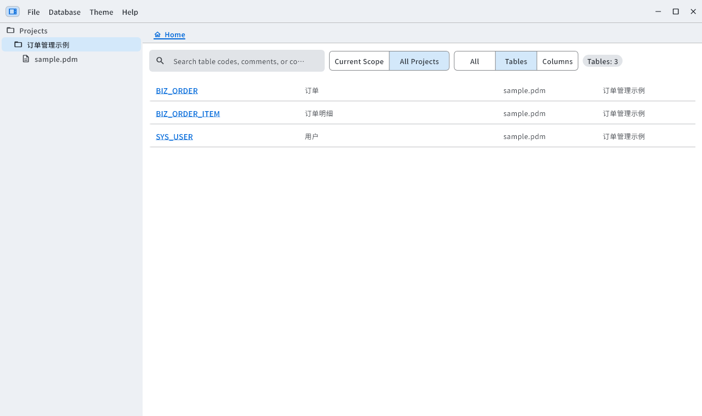
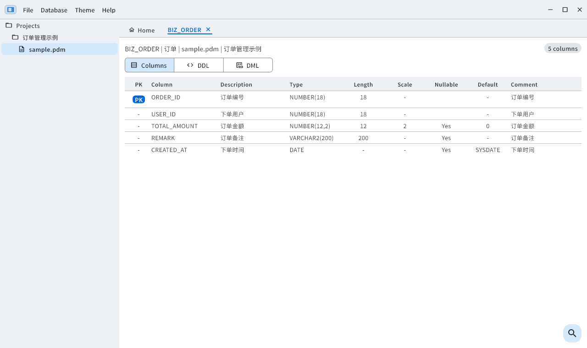
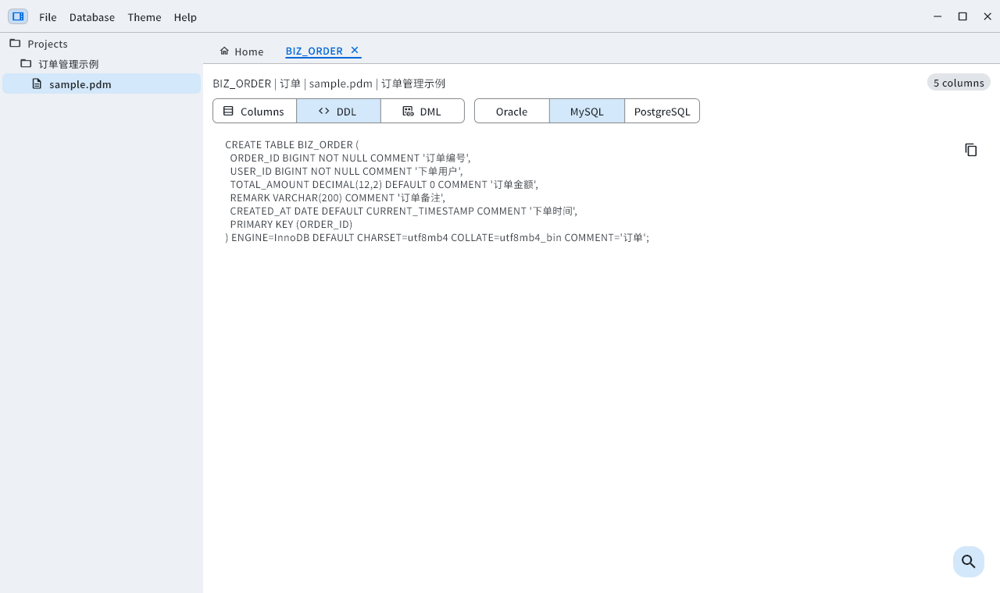
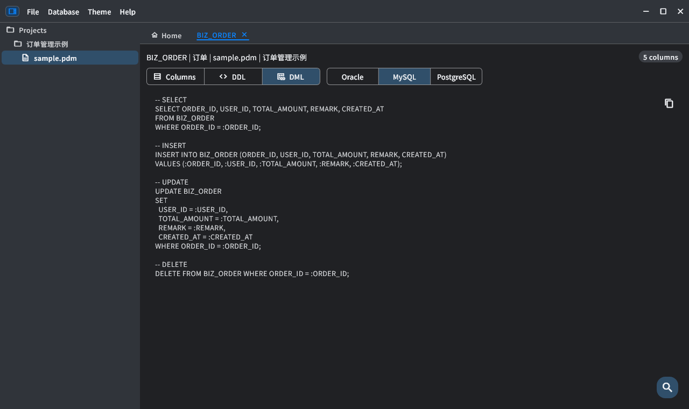
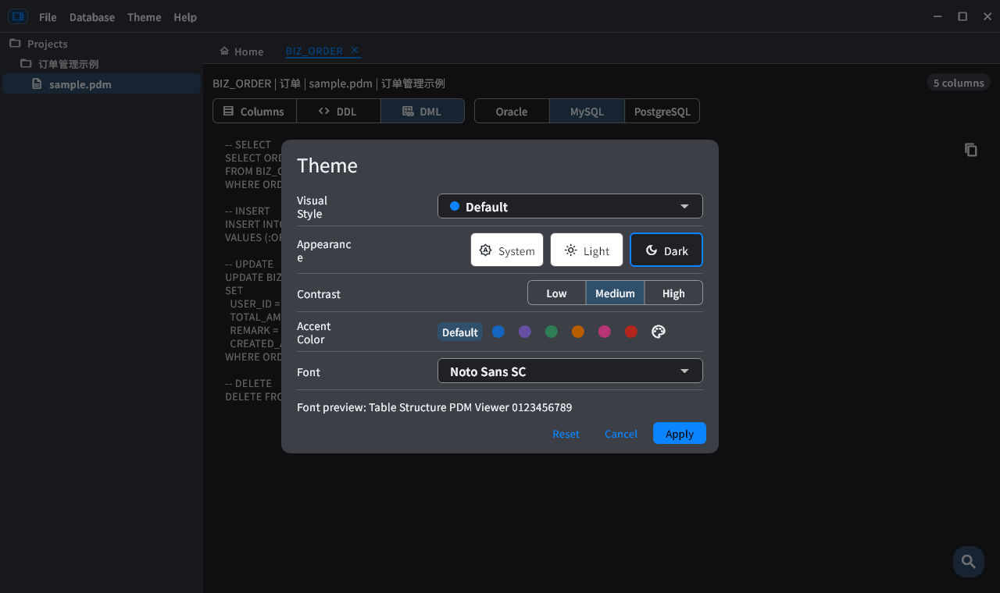
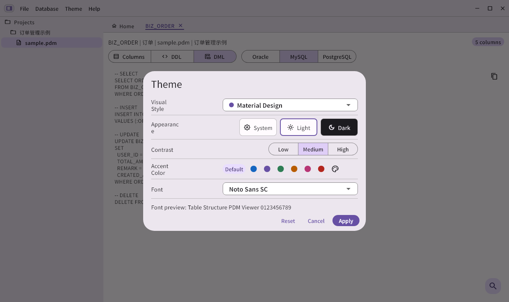
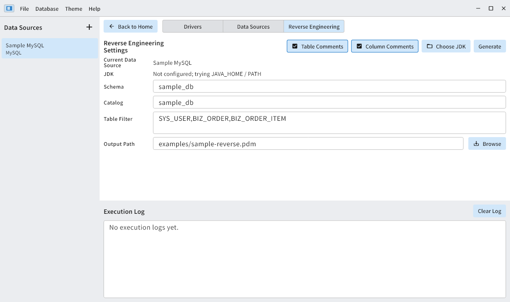
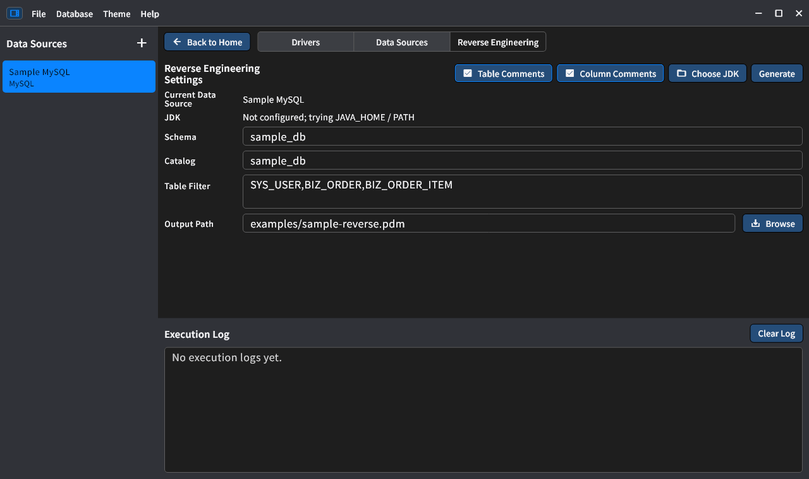

<div align="center">

#  PdmViewer

### Browse database models. Find columns. Preview SQL.


**English** | **[简体中文](README_zh.md)**

[Screenshots](#interface-preview) · [Features](#key-features) · [Requirements](#system-requirements) · [Getting Started](#getting-started) · [Themes](#theme-switching-example) · [Reverse Engineering](#jdbc-reverse-engineering-optional) · [Build](#development-and-builds)

</div>

---

PdmViewer is a Flutter desktop tool for browsing and searching PowerDesigner `.pdm` files.
Organize models by project, inspect tables in tabs, and generate Oracle, MySQL, or PostgreSQL SQL without connecting to a database.
**Java is not required for everyday PDM viewing.** JDBC reverse engineering is a separate, optional workflow.

## Interface Preview

All screenshots are rendered from the actual application using only [`examples/sample.pdm`](examples/sample.pdm).
No production models or database credentials are shown. Sample names and comments remain Chinese; interface language can be changed independently.
Window controls and system fonts vary by platform.

### Projects and Table Search

Search the current scope or all projects. Click a table-name link to open its detail tab.



### Column Details

Inspect types, keys, lengths, scales, defaults, and comments. Resize columns, select cells, and find matches.



### DDL Preview

Switch SQL dialects and copy generated statements. Below: MySQL DDL for `BIZ_ORDER`.



### DML and Dark Mode

Generate CRUD templates with light, dark, or system appearance. SQL is a template for review; the viewer does not execute it.



### Theme Settings in Different Styles

**Default · Dark**



**Material Design · Light**



### Reverse Engineering in Different Styles

These screenshots show example configuration only, with no database connection or execution. The filter uses table names from `examples/sample.pdm`; no real credentials are included.

**Fluent Design · Light**



**macOS-inspired · Dark**



## Key Features

| Area | Capabilities |
| --- | --- |
| Projects | Multiple PDM files, file-change checks, containing folders, locate the active table in the tree |
| Search | Tables and columns within a project, a PDM file, or all projects |
| Table workspace | Multiple detail tabs, resizable columns, cell/range selection, row/column copy, camelCase copy |
| SQL | Oracle / MySQL / PostgreSQL DDL and CRUD templates; project, PDM, or multi-table previews; copy and save `.sql` |
| Find in page | Match case, whole words, previous/next navigation in columns and SQL |
| Appearance | Default, Material Design, Fluent Design, and macOS-inspired styles; accent colors, system fonts, contrast, light/dark/system modes |
| Languages | English and Simplified Chinese via **Help → Language**, remembered across restarts |
| Local storage | SQLite project/search index; no database connection needed to browse imported models |
| Optional reverse engineering | JDBC drivers, data sources, metadata SQL, execution logs, and PDM export |

Large SQL previews display only the first **200 tables**; find-in-preview searches that subset. **Copy all and save still include every selected table.** DDL and comment generation are independently selectable.

Visual styles use shared Flutter components with style-specific configuration, not separate native WinUI or AppKit implementations.

## Support the Author

If PdmViewer helps you, optional donations are welcome via **Help → Support the Author**.
Scan a code below with Alipay or WeChat. Donations are voluntary and do not unlock extra features.

<p align="center">
  
  &nbsp;&nbsp;
  
</p>
<p align="center">Alipay · WeChat Pay</p>

## System Requirements

| Item | Requirement |
| --- | --- |
| Windows | Windows 10/11, 64-bit; a package matching x64 or ARM64. The corresponding Microsoft Visual C++ 2015–2022 runtime may be required. |
| macOS | Intel or Apple Silicon, matching the package. Project deployment target: macOS 10.15; release compatibility also depends on its Flutter SDK and native plugins. |
| Display | Minimum window: **800 × 500** logical pixels; **1280 × 720 or larger** recommended. |
| Storage | A writable system application-support directory for settings and SQLite indexes; usage depends on imported models. |
| Java | **JDBC reverse engineering only:** JDK 8+ with both `java` and `javac`, and user-supplied JDBC JARs. |

Linux is not configured as an application target in this repository. No 32-bit x86 builds are supported.
Build options do not imply that every architecture has a published or tested binary.

## Getting Started

1. Windows: keep the entire release folder together and run `PdmViewer.exe`, not the EXE alone. macOS: launch `PdmViewer.app`.
2. Create a project with **+** in the left tree, then choose **Add PDM** from its context menu.
3. Import [`examples/sample.pdm`](examples/sample.pdm) and click a table-name link.
4. Try the column, DDL, and DML views, or select tables and right-click **Preview SQL**.
5. Choose **Help → Language → English / 简体中文**. Reopen onboarding with **Help → Getting Started**.

| Sample table | Original name | Columns | Demonstrates |
| --- | --- | ---: | --- |
| `SYS_USER` | 用户 | 5 | Primary key, status default, creation date |
| `BIZ_ORDER` | 订单 | 5 | Amount, nullable comment, date default |
| `BIZ_ORDER_ITEM` | 订单明细 | 5 | Composite primary key, quantity and unit price |

By default, Chinese system language settings use Chinese; all other system languages use English. A manual language selection is saved and takes precedence over the system setting.
UI language does not translate project names, PDM metadata, SQL, or driver-provided diagnostics.

## Theme Switching Example

Open **Theme → Theme**, change the settings, then choose **Apply**. **Cancel** discards the pending changes.

| Setting | Example and behavior |
| --- | --- |
| Visual Style | **Default** for everyday work, or Material Design, Fluent Design, and macOS-inspired styles |
| Appearance | **System** follows OS appearance; **Light** and **Dark** override it |
| Contrast | Low / Medium / High, adjusting text, control boundaries, and accent contrast together |
| Accent Color | Use the style's default, a preset color, or the palette button for a custom color |
| Font | System Default, or a font installed on your computer |

For example, choose **Default + Light + Medium contrast + Blue** during the day. Switch to **Dark** at night, or choose **System** to follow the OS. Applied settings persist across restarts.
To restore the initial appearance, choose **Reset**, review the settings, and choose **Apply**.

See the [column details](#column-details) and [dark-mode DML](#dml-and-dark-mode) screenshots above for light and dark examples.

## JDBC Reverse Engineering (Optional)

Open **Database → Drivers / Data Sources / Reverse Engineer PDM**.

1. Install a JDK 8+ yourself. The application checks the Java environment; select a JDK directory if needed.
2. Choose JDBC JARs in Drivers and review the driver class, URL template, and metadata SQL.
3. Create a data source with URL, username, and password, then test its connection.
4. Choose a source, schema/catalog and optional table-name list or regex filter; choose an output path and generate a `.pdm`.

Templates cover MySQL, Oracle, PostgreSQL, OceanBase MySQL/Oracle, and DaMeng. Custom drivers and SQL are supported.
**JDKs and driver JARs are not bundled.** Another schema requires appropriate metadata permissions.
Current export covers tables, columns, primary keys, and comments, not foreign keys, indexes, views, procedures, or triggers. Check generated models in the intended PowerDesigner version.

### Example: MySQL to PDM

The connection details below are placeholders: replace them with your own database. Table names come from `examples/sample.pdm`; those tables must actually exist in your database.

1. Open **Database → Drivers**, select the MySQL template, choose a local MySQL Connector/J JAR, confirm the driver class is `com.mysql.cj.jdbc.Driver`, and choose **Save**.
2. Open **Database → Data Sources**, choose **Add**, and enter the settings below. Choose **Test Connection**, then **Save** after a successful test.

| Setting | Example |
| --- | --- |
| Data Source Name | `Sample MySQL` |
| Driver | The MySQL driver configured above |
| JDBC URL | `jdbc:mysql://127.0.0.1:3306/sample_db?useUnicode=true&characterEncoding=utf8&useSSL=false` |
| Username / Password | Your read-only credentials, with permission to read the target tables' metadata |
| Schema / Catalog | Set both to `sample_db` for this example |

3. Open **Database → Reverse Engineer PDM**, select `Sample MySQL` on the left, review Schema / Catalog, and enable **Table Comments / Column Comments** as needed.
4. Enter `SYS_USER,BIZ_ORDER,BIZ_ORDER_ITEM` in **Table Filter**, choose an output path such as `sample-reverse.pdm`, and choose **Generate**.
5. Watch the execution log for actual SQL, read progress, and results. After success, use **Add PDM** on a home-screen project to import the file and check tables, columns, keys, and comments.

### Filters and Other Schemas

| Table Filter | Behavior |
| --- | --- |
| Empty | All accessible tables in the selected scope |
| `SYS_USER,BIZ_ORDER` | A comma-separated list of table names |
| `^BIZ_` | A regular expression matching the business-table prefix |
| `^SYS_USER$` | An exact single-table regular expression |

Both lists and regexes are case-insensitive. A single entry is treated as a regex; use `^` and `$` for exact matching.

For Oracle / OceanBase Oracle, the login user and target Schema may differ: for example, connect as read-only user `READER` and set **Schema** to table owner `APP_OWNER`. The account must see the target tables through the `ALL_*` metadata views. **A successful connection test does not verify access to the target Schema.**
Built-in SQL replaces `%SCHEMA%` / `%CATALOG%` before execution. An empty Schema uses the connection's current schema, falling back to the current username if unavailable. Do not hard-code placeholders such as `YOUR_SCHEMA` in custom SQL.
If no tables are exported or a stage takes too long, inspect the actual SQL, target schema, current stage, and errors in the log before checking permissions and driver settings.

Settings and indexes are stored in a `PdmViewer` subdirectory of the OS application-support directory: `PdmViewer.db` and `theme.json`.
Source PDM files are not modified; export paths are user-selected.
**Data-source settings may contain credentials. Protect local configuration and do not commit it.**

## Development and Builds

Use a Flutter SDK containing Dart compatible with **`^3.11.1`**.
Windows needs Visual Studio C++ desktop tools; macOS needs Xcode and the native plugin toolchain. Build on the target OS.

```sh
flutter pub get
flutter doctor
dart analyze
flutter test
```

```sh
# Windows: use a matching native Flutter/Dart SDK
dart run tooling/build_desktop.dart --platform=windows --arch=x64
dart run tooling/build_desktop.dart --platform=windows --arch=arm64

# macOS: on a Mac; universal includes Intel and Apple Silicon
dart run tooling/build_desktop.dart --platform=macos --arch=universal
# Also supported: --arch=x64 or --arch=arm64

# Inspect commands without building
dart run tooling/build_desktop.dart --platform=macos --arch=universal --dry-run
```

| Target | Default output |
| --- | --- |
| Windows | `build/windows/<arch>/runner/Release/PdmViewer.exe` and accompanying files |
| macOS | `build/macos/Build/Products/Release/PdmViewer.app` |

Native plugins must support the chosen architecture. macOS builds share one output directory: archive each before building another architecture.
The script verifies architecture; it does not sign, notarize, create installers, or bundle Java.
See [build details and Linux compatibility notes](docs/building.md) (Chinese).

## Project Layout

| Path | Purpose |
| --- | --- |
| `lib/app/` | Shell, state, localization resources, themes |
| `lib/ui/` | Workspace, database management, shared widgets |
| `lib/data/` | SQLite repositories, PDM parser/writer, JDBC services |
| `lib/domain/` | Project, table, search, and reverse-engineering models |
| `tooling/` | Desktop build script and Java JDBC helper |
| `examples/` | Importable sample PDM |
| `test/` | Unit/widget tests and optional screenshot capture |
| `docs/` | Screenshots and implementation notes |

See [component styles](docs/component-styles.md) (Chinese).
System UI fonts are not bundled; bundled icon-font notices are in [`assets/licenses/`](assets/licenses/).
