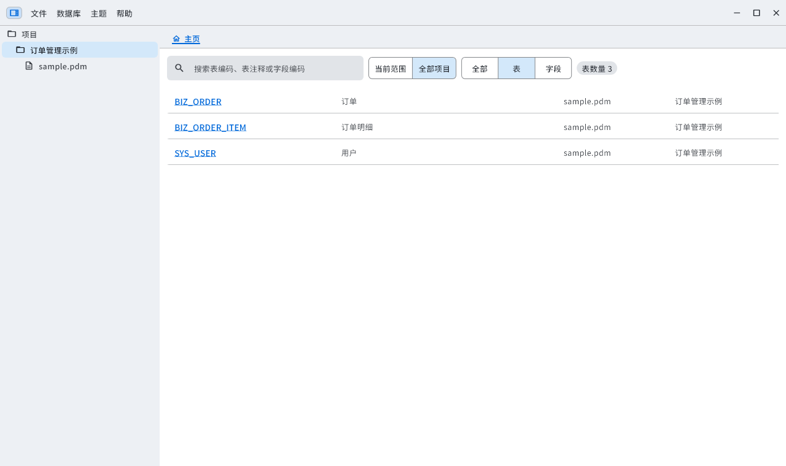
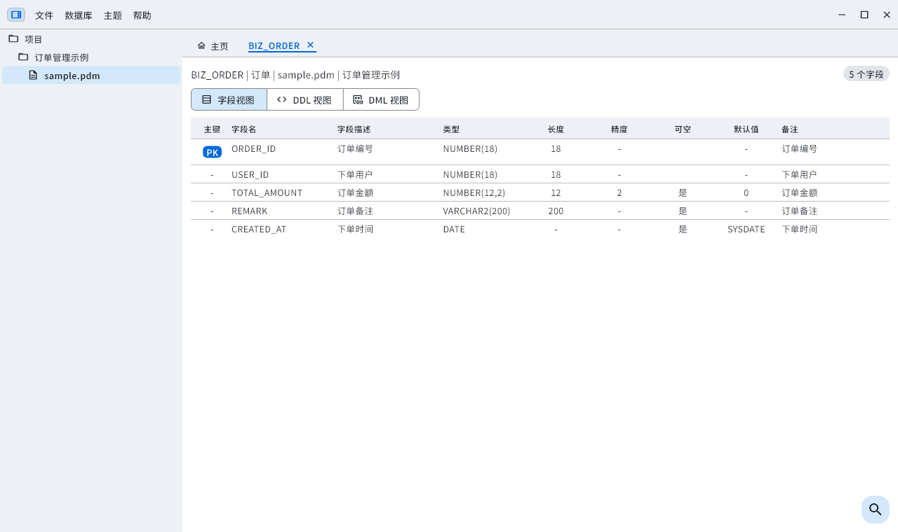
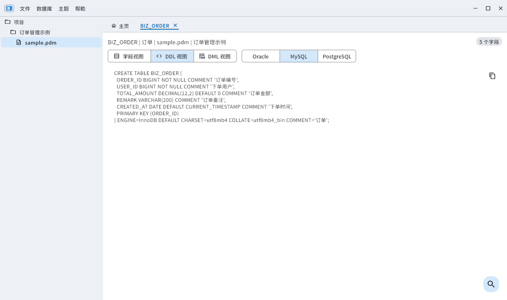
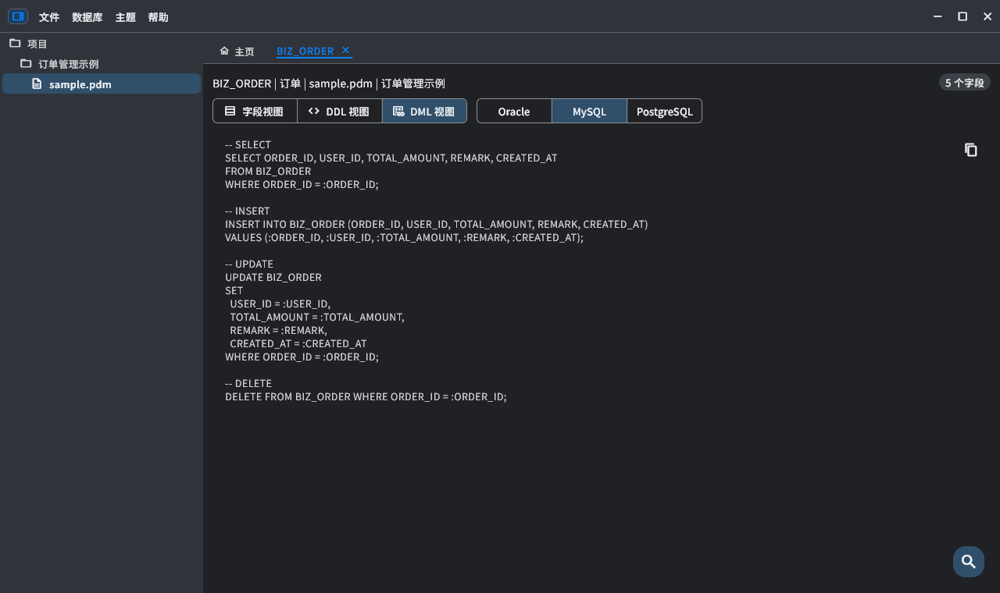
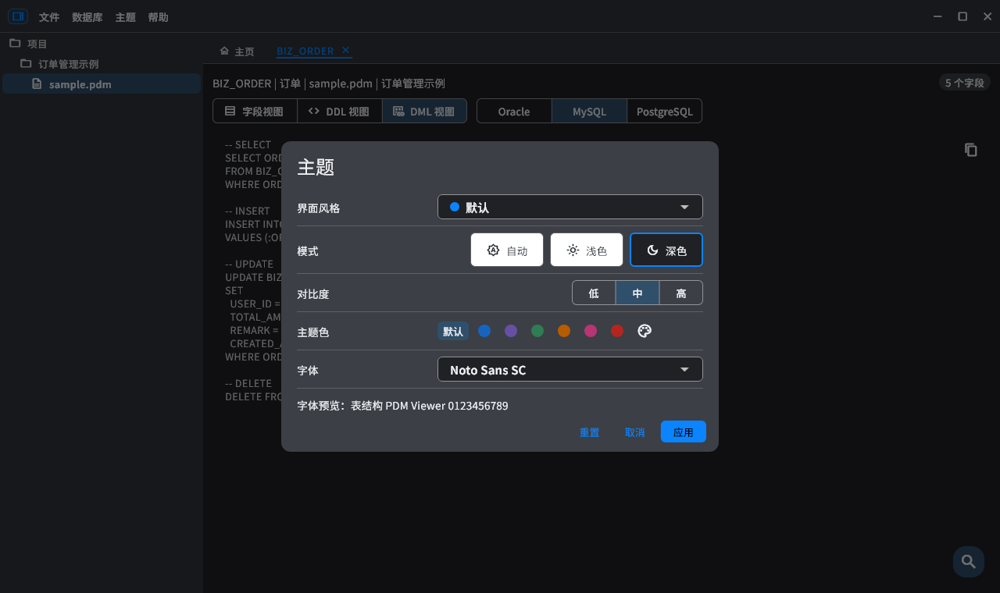
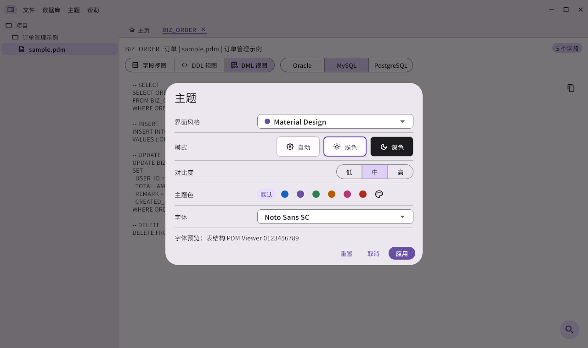
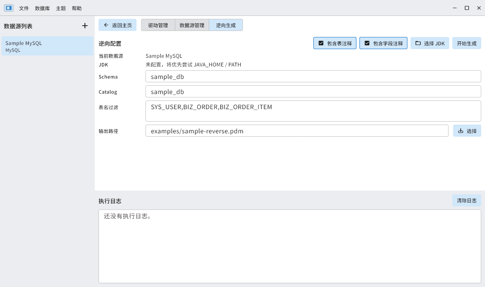
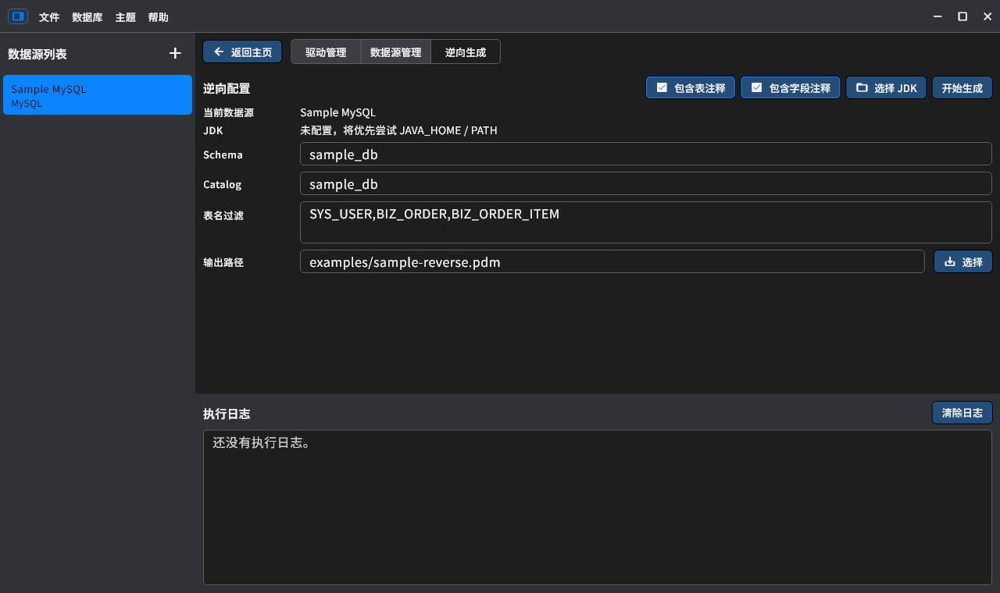

<div align="center">

#  PdmViewer

### 浏览数据模型，快速查找字段，预览生成 SQL。


**[English](README.md)** | **简体中文**

[界面预览](#界面预览) · [主要功能](#主要功能) · [系统要求](#系统要求) · [快速开始](#快速开始) · [主题切换](#主题切换示例) · [数据库逆向](#数据库逆向可选) · [开发与打包](#开发与打包)

</div>

---

PdmViewer 是使用 Flutter 构建的 PowerDesigner `.pdm` 文件查看与检索工具。
按项目管理模型，多页签查看表结构，生成 Oracle、MySQL、PostgreSQL SQL，无需连接数据库。
**日常查看 PDM 无需 Java。** JDBC 数据库逆向为独立的可选功能。

## 界面预览

以下截图均由应用真实界面组件渲染，仅使用 [`examples/sample.pdm`](examples/sample.pdm)，不包含业务文件或真实数据库连接信息。
示例中的表名、注释保留中文，界面语言可独立切换；不同平台的系统字体与窗口控制区域可能不同。

### 项目与表列表

搜索当前范围或全部项目，点击表名链接打开详情页签。



### 字段详情

查看类型、主键、长度、精度、默认值与备注，支持调整列宽、选择单元格和搜索定位。



### DDL 视图

切换数据库类型并复制生成的语句，下图为 `BIZ_ORDER` 的 MySQL DDL。



### DML 与深色模式

生成增删改查模板，支持浅色、深色及跟随系统。SQL 是供检查与调整的模板，不会在数据库中执行。



### 不同风格的主题设置

**默认 · 深色**



**Material Design · 浅色**



### 不同风格的逆向页面

以下截图仅展示示例配置，没有连接数据库或执行逆向。过滤条件使用 `examples/sample.pdm` 中的表名，不包含真实凭据。

**Fluent Design · 浅色**



**macOS 风格 · 深色**



## 主要功能

| 功能 | 说明 |
| --- | --- |
| 项目管理 | 导入多个 PDM、检查文件变更、打开所在文件夹、定位当前表对应的 PDM |
| 表与字段搜索 | 按项目、单个 PDM 或全部项目检索 |
| 表格工作区 | 多页签、列宽调整、单元格与范围选择、整行/整列复制、驼峰复制 |
| SQL 生成 | Oracle / MySQL / PostgreSQL DDL 与 CRUD 模板；按项目、PDM、多表预览，复制或保存 `.sql` |
| 页内查找 | 区分大小写、全字匹配、上一个/下一个；支持字段及 SQL 视图 |
| 主题与字体 | 默认、Material Design、Fluent Design、macOS 风格；主题色、系统字体、对比度及浅色/深色/自动模式 |
| 中英文界面 | 从 **帮助 → 语言** 即时切换，重启后保留选择 |
| 本地索引 | SQLite 保存项目和检索索引，浏览模型无需连接数据库 |
| 可选数据库逆向 | JDBC 驱动、数据源、元数据 SQL、执行日志、PDM 导出 |

大批量 SQL 预览仅展示前 **200 张表**，搜索也限于可见预览；**复制全部与保存文件仍包含全部选中的表**。生成 DDL 与生成注释可分别控制。

不同风格通过同一套 Flutter 组件的样式配置实现，不是独立的原生 WinUI 或 AppKit 组件。

## 赞赏作者

如果 PdmViewer 对你有帮助，欢迎通过 **帮助 → 赞赏作者** 自愿支持作者。
也可以使用支付宝或微信扫描下方收款码。赞赏完全自愿，不影响任何功能的使用。

<p align="center">
  
  &nbsp;&nbsp;
  
</p>
<p align="center">支付宝 · 微信支付</p>

## 系统要求

| 项目 | 要求 |
| --- | --- |
| Windows | Windows 10/11，64 位；选择对应 x64 或 ARM64 包。可能需要对应架构的 Microsoft Visual C++ 2015–2022 运行库。 |
| macOS | Intel 或 Apple Silicon，选择对应架构包。工程部署目标为 macOS 10.15，实际兼容范围还取决于发布使用的 Flutter SDK 与原生插件。 |
| 显示 | 应用最小窗口为 **800 × 500** 逻辑像素，建议 **1280 × 720** 或更高。 |
| 存储 | 系统应用支持目录需可写，用于设置和 SQLite 索引；空间需求随导入模型数量变化。 |
| Java | **仅 JDBC 逆向需要**：同时包含 `java` 与 `javac` 的 JDK 8+，以及用户提供的 JDBC 驱动 JAR。 |

仓库未配置 Linux 应用目标，不支持 32 位 x86。脚本提供架构选项，不代表所有组合都已有发布包或完成实机验证。

## 快速开始

1. Windows 保留完整发布目录，运行 `PdmViewer.exe`，不要只复制 EXE；macOS 打开 `PdmViewer.app`。
2. 点击左侧树的 **+** 新增项目，在项目右键菜单选择 **新增 PDM**。
3. 导入 [`examples/sample.pdm`](examples/sample.pdm)，点击表名链接查看详情。
4. 切换字段、DDL、DML 视图，或选中多张表后右键 **预览 SQL**。
5. 通过 **帮助 → 语言** 切换 **简体中文 / English**；通过 **帮助 → 使用向导** 重看操作提示。

| 示例表 | 名称 | 字段数 | 内容 |
| --- | --- | ---: | --- |
| `SYS_USER` | 用户 | 5 | 主键、状态默认值、创建时间 |
| `BIZ_ORDER` | 订单 | 5 | 金额、可空备注、日期默认值 |
| `BIZ_ORDER_ITEM` | 订单明细 | 5 | 复合主键、数量与单价 |

默认根据系统语言选择：中文语言环境使用中文，其它语言使用英文；手动切换后保存选择，并优先使用该设置。
切换语言不会翻译项目名、PDM 元数据、SQL 或驱动返回的原始诊断信息。

## 主题切换示例

从顶部 **主题 → 主题** 打开设置，修改后点击 **应用**；点击 **取消** 不保存本次更改。

| 设置项 | 示例与说明 |
| --- | --- |
| 界面风格 | **默认**适合日常工作，也可切换 Material Design、Fluent Design 或 macOS 风格 |
| 模式 | **自动**跟随系统；也可固定为**浅色**或**深色** |
| 对比度 | 低 / 中 / 高，联动调整文字、控件边界及主题色对比度 |
| 主题色 | 使用当前风格的默认色、预设色，或点击调色板自定义 |
| 字体 | 默认使用系统字体，也可选择本机已安装字体 |

例如，白天选择 **默认 + 浅色 + 中对比度 + 蓝色**；夜间将模式切换为 **深色**，或选择 **自动**交给系统控制。设置应用后会保存，重启后仍生效。
需要恢复初始设置时，点击 **重置**，确认设置后点击 **应用**。

浅色表格与深色 SQL 的实际效果可参考上方[字段详情](#字段详情)和[DML 与深色模式](#dml-与深色模式)截图。

## 数据库逆向（可选）

从 **数据库 → 驱动管理 / 数据源管理 / 逆向生成 PDM** 进入。

1. 自行准备 JDK 8+。应用检查 Java 环境，必要时手动选择 JDK 目录。
2. 在驱动管理选择 JDBC JAR，检查驱动类、URL 模板及元数据 SQL。
3. 新增数据源，填写 URL、用户名、密码并测试连接。
4. 选择数据源，设置 schema/catalog、表名列表或正则过滤，选择路径并生成 `.pdm`。

内置 MySQL、Oracle、PostgreSQL、OceanBase MySQL/Oracle、达梦模板，也支持自定义 JDBC 驱动及 SQL。
**应用不附带 JDK 与驱动包**，访问其他 schema 需要相应数据库权限。
当前导出范围为表、字段、主键与注释，不含外键、索引、视图、存储过程、触发器；生成模型应在目标 PowerDesigner 版本中确认。

### 示例：MySQL 逆向生成 PDM

以下连接信息仅为占位示例，需要替换为自己的数据库；表名沿用 `examples/sample.pdm`，数据库中需实际存在这些表。

1. 打开 **数据库 → 驱动管理**，选择 MySQL 模板，选择本地 MySQL Connector/J JAR，确认驱动类为 `com.mysql.cj.jdbc.Driver`，点击 **保存**。
2. 打开 **数据库 → 数据源管理**，点击 **新增**，按下表填写；点击 **测试连接**，成功后点击 **保存**。

| 配置项 | 示例 |
| --- | --- |
| 数据源名称 | `Sample MySQL` |
| 驱动 | 上一步配置的 MySQL 驱动 |
| JDBC URL | `jdbc:mysql://127.0.0.1:3306/sample_db?useUnicode=true&characterEncoding=utf8&useSSL=false` |
| 用户名 / 密码 | 自己的只读账户及密码，需具有读取目标表元数据的权限 |
| Schema / Catalog | 本例均填写 `sample_db` |

3. 打开 **数据库 → 逆向生成 PDM**，在左侧选中 `Sample MySQL`，确认 Schema / Catalog，按需勾选 **包含表注释 / 包含字段注释**。
4. **表名过滤**填写 `SYS_USER,BIZ_ORDER,BIZ_ORDER_ITEM`，选择输出路径（例如 `sample-reverse.pdm`），点击 **开始生成**。
5. 在执行日志中查看实际 SQL、读取进度和结果；成功后，从主页项目的 **新增 PDM** 导入生成文件，检查表、字段、主键和注释。

### 过滤与跨 Schema 提示

| 表名过滤 | 含义 |
| --- | --- |
| 留空 | 导出当前范围内可访问的全部表 |
| `SYS_USER,BIZ_ORDER` | 按逗号分隔的表名列表匹配 |
| `^BIZ_` | 使用正则匹配业务表前缀 |
| `^SYS_USER$` | 用正则精确匹配单个表 |

列表与正则匹配均不区分大小写。单项按正则处理，精确匹配建议加 `^` 和 `$`。

Oracle / OceanBase Oracle 中，登录用户与目标 Schema 可以不同：例如登录只读用户 `READER`，将 **Schema** 填为表所属用户 `APP_OWNER`。该账户必须能通过 `ALL_*` 元数据视图看到目标表；**测试连接成功不代表拥有目标 Schema 的访问权限**。
内置 SQL 的 `%SCHEMA%` / `%CATALOG%` 会在执行前替换；Schema 留空时使用连接的当前 Schema，无法获取时回退到当前用户名。自定义 SQL 不应把 `YOUR_SCHEMA` 等示例值写死。
若没有导出表或某一步耗时较长，先查看日志中的实际 SQL、目标 Schema、读取阶段及错误信息，再检查权限与驱动配置。

项目、配置与索引位于系统应用支持目录的 `PdmViewer` 子目录，包含 `PdmViewer.db` 与 `theme.json`。
不会修改源 PDM 文件，导出路径由用户选择。**数据源配置可能包含密码，请保护本地配置，不要提交到仓库。**

## 开发与打包

使用包含与 **`^3.11.1`** 兼容 Dart 版本的 Flutter SDK。Windows 需要 Visual Studio C++ 桌面开发工具，macOS 需要 Xcode 及原生插件构建环境。请在目标系统上构建。

```sh
flutter pub get
flutter doctor
dart analyze
flutter test
```

```sh
# Windows：使用对应架构的原生 Flutter/Dart SDK
dart run tooling/build_desktop.dart --platform=windows --arch=x64
dart run tooling/build_desktop.dart --platform=windows --arch=arm64

# macOS：在 Mac 上构建，universal 包含 Intel 与 Apple Silicon
dart run tooling/build_desktop.dart --platform=macos --arch=universal
# 也支持 --arch=x64 或 --arch=arm64

# 仅查看命令，不构建
dart run tooling/build_desktop.dart --platform=macos --arch=universal --dry-run
```

| 平台 | 默认输出 |
| --- | --- |
| Windows | `build/windows/<arch>/runner/Release/PdmViewer.exe` 及配套文件 |
| macOS | `build/macos/Build/Products/Release/PdmViewer.app` |

原生插件也需要支持目标架构。macOS 不同架构共用输出目录，再次构建前请归档。
脚本校验产物架构，不负责签名、公证、安装器或 Java 打包。
详见 [多架构构建与 Linux 兼容说明](docs/building.md)。

## 目录说明

| 路径 | 用途 |
| --- | --- |
| `lib/app/` | 应用框架、状态、本地化资源与主题 |
| `lib/ui/` | 工作区、数据库管理与通用组件 |
| `lib/data/` | SQLite 仓储、PDM 解析/生成、JDBC 服务 |
| `lib/domain/` | 项目、表字段、搜索与逆向模型 |
| `tooling/` | 桌面构建脚本、Java JDBC 助手 |
| `examples/` | 可导入的示例 PDM |
| `test/` | 单元/界面测试与可选截图生成 |
| `docs/` | 截图与实现说明 |

组件样式说明见 [component-styles.md](docs/component-styles.md)。不附带系统界面字体，随包图标字体声明见 [`assets/licenses/`](assets/licenses/)。
